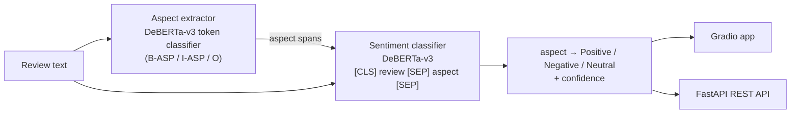

# Customer Feedback Intelligence: End-to-End Aspect-Based Sentiment Analysis

[](https://github.com/nxl-krishna/Aspect-Based-Sentiment-Analysis-ABSA-/actions/workflows/tests.yml)
[](https://huggingface.co/spaces/nxl-krishna/sentiment-analysis)

Paste a customer review and get back **every product aspect it mentions and the sentiment toward each one**:

> "The pasta was delicious, but the waiter was rude and we waited an hour for the bill."
>
> → **pasta**: Positive (99.9%) · **waiter**: Negative (99.8%) · **bill**: Negative (94.3%)

Overall sentiment would call that review "mixed". ABSA tells a restaurant manager *what* to fix.

Both models are trained by me on SemEval-2014 Task 4 and evaluated on the **official test sets**:

| Task | Model | Restaurants | Laptops |
|---|---|---|---|
| Aspect term extraction (span F1) | DeBERTa-v3-base BIO tagger | **90.8 ± 0.5** | **86.0 ± 0.7** |
| Aspect sentiment (accuracy) | DeBERTa-v3-base sentence-pair classifier | **87.1 ± 0.3** | **82.7 ± 0.5** |
| Aspect sentiment (macro-F1) | DeBERTa-v3-base sentence-pair classifier | **79.8 ± 0.3** | **79.1 ± 0.7** |

Mean ± std over 3 seeds. Full benchmark (7 models): [reports/RESULTS.md](reports/RESULTS.md) · Error analysis: [reports/ERROR_ANALYSIS.md](reports/ERROR_ANALYSIS.md)

## How it works



1. **Aspect extraction**: character-level aspect spans from the XML are projected onto subword tokens as BIO labels using the tokenizer's offset mapping (round-trip is lossless on the test sets), then decoded back to exact character spans at inference.
2. **Aspect sentiment**: each (review, aspect) pair is encoded as a sentence pair so self-attention can relate the aspect to its opinion words. Truncation only ever cuts the review, never the aspect.
3. **Serving**: batched GPU inference behind a Gradio app (Hugging Face Spaces, ZeroGPU) and a FastAPI service with single, review-level and CSV batch endpoints.

## Benchmark: from TF-IDF to DeBERTa


| Model | Restaurants Acc | Laptops Acc | Laptops Macro-F1 |
|---|---|---|---|
| TF-IDF + Logistic Regression | 72.4 | 57.7 | 53.1 |
| BiLSTM (GloVe) | 72.9 ± 1.0 | 64.5 ± 1.2 | 57.2 ± 2.0 |
| BiLSTM + aspect attention (from scratch) | 74.1 ± 0.6 | 65.4 ± 1.5 | 59.7 ± 1.3 |
| DistilBERT (fine-tuned) | 85.0 ± 0.6 | 77.7 ± 0.6 | 73.6 ± 0.5 |
| **DeBERTa-v3-base (fine-tuned)** | **87.1 ± 0.3** | **82.7 ± 0.5** | **79.1 ± 0.7** |

## Key findings

- **Pre-training matters most on the harder domain.** On Laptops, DeBERTa beats the best non-transformer model by 17 accuracy points (82.7 vs 65.4), more than on Restaurants (+13), where surface cues like "delicious" carry further.
- **Aspect-conditioned attention helps recurrent models, but modestly.** On Laptops it improved macro-F1 over a plain BiLSTM in every seed (+1.1 to +3.3, mean +2.5). On Restaurants the mean gain (+1.3 accuracy) is within seed-to-seed noise, which is why I report 3 seeds rather than one lucky run.
- **Mixed-sentiment sentences are the real challenge.** Accuracy is 89.9% when all aspects in a sentence share a sentiment but **74.0%** when they differ ("great food, rude staff"), the exact case ABSA exists for.
- **Neutral is the bottleneck.** 68% of the final model's errors are neutral aspects predicted as positive or negative. Many of its most confident "mistakes" are wishes or descriptions ("I *needed* a laptop with a nice screen", "meaty chili") where the gold label is debatable.
- **Class-weighted loss did not fix it.** Re-weighting the loss toward the rare neutral class moved neutral F1 by less than 0.5 points (61.7 vs 61.4 Restaurants, 66.7 vs 66.8 Laptops, 3 seeds each), well within seed noise. The bottleneck is ambiguity, not class imbalance, so the deployed model keeps plain cross-entropy.

## Engineering notes

- **Reproducible experiments**: YAML configs, fixed seeds, 3-seed runs, one script ([scripts/run_experiments.ps1](scripts/run_experiments.ps1)) reproduces every number; results are written as JSON and aggregated into the report by [src/evaluation/make_report.py](src/evaluation/make_report.py).
- **A real training bug, found and fixed**: in Transformers 5, `from_pretrained` keeps a checkpoint's stored dtype. `deberta-v3-base` ships in fp16, so training silently ran in pure fp16 and collapsed to predicting the majority class. Diagnosed with a 64-example overfitting test (DeBERTa loss → NaN while DistilBERT converged); fixed by loading fp32 master weights and training with bf16 autocast.
- **Tested**: 20 pytest tests (BIO conversion edge cases, span metrics, XML parsing, every API endpoint with fake models) run in GitHub Actions.
- **Latency** (both models, full pipeline, [src/evaluation/benchmark_latency.py](src/evaluation/benchmark_latency.py)): 59 ms median per review on an RTX 3050 Laptop GPU and 121 reviews/s batched; 158 ms median on CPU.
- **Production details**: sync FastAPI endpoints so blocking inference runs in a threadpool, input validation, correct 4xx vs 5xx errors, BOM-tolerant CSV parsing, model locations configurable via environment variables with graceful fallback.

## Project structure

```
api/main.py                     FastAPI service (/analyze, /analyze-review, /batch-analyze, /health)
app.py                          Gradio app deployed on Hugging Face Spaces
configs/                        Training configs (YAML)
src/data/semeval.py             SemEval-2014 XML loading
src/data/bio.py                 Character span <-> BIO token label conversion
src/models/rnn.py               BiLSTM and aspect-attention models (PyTorch, from scratch)
src/training/                   train_sentiment.py, train_extraction.py, train_baselines.py
src/evaluation/                 metrics, report generation, error analysis, latency benchmark
src/inference/infer.py          AspectExtractor, ABSA_Inferencer, end-to-end ABSAPipeline
reports/                        RESULTS.md, ERROR_ANALYSIS.md, per-run JSON, figures
notebooks/                      Original exploration notebooks (EDA, baselines, BiLSTM, attention, DistilBERT)
tests/                          pytest suite
```

## Reproduce

```powershell
python -m venv venv; .\venv\Scripts\Activate
pip install torch --index-url https://download.pytorch.org/whl/cu128   # or the CPU wheel
pip install -r requirements-dev.txt
python -m spacy download en_core_web_md

python scripts/download_semeval.py          # official train + gold test XML
python -m src.training.train_extraction --config configs/extraction_deberta.yaml
python -m src.training.train_sentiment --config configs/sentiment_deberta.yaml
python -m src.training.train_baselines
python -m src.evaluation.make_report
python -m src.evaluation.error_analysis
pytest
```

Run the app or API locally (uses the models in `models/` if present):

```powershell
python app.py                       # Gradio UI at http://localhost:7860
uvicorn api.main:app --reload       # API docs at http://localhost:8000/docs
```

Publish the models so the Space uses them:

```powershell
hf auth login
python scripts/push_to_hub.py --user nxl-krishna
```

## Limitations

- SemEval-2014 covers two domains with ~6k training aspects; performance on other product categories is untested.
- The extractor finds explicit aspect terms only; implicit aspects ("it died after two hours" → battery) are out of scope.
- Neutral recall remains the weakest point (see error analysis).
